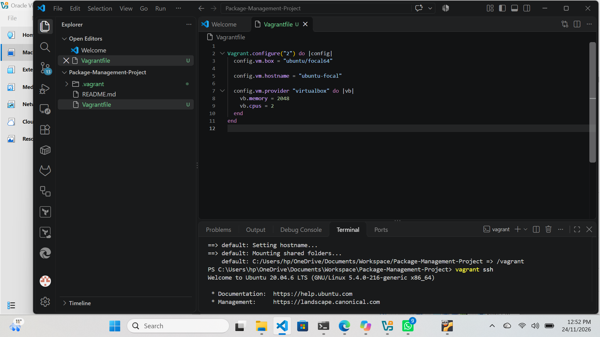
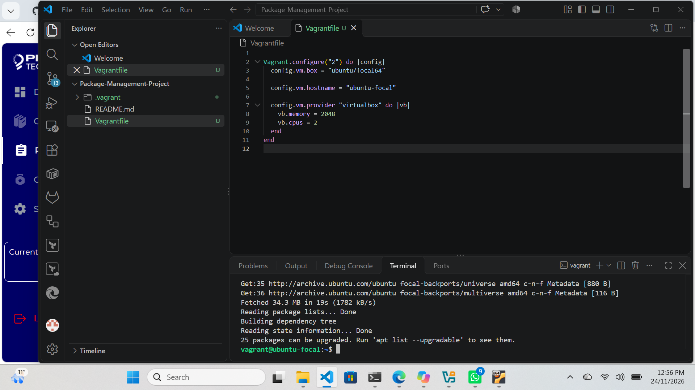
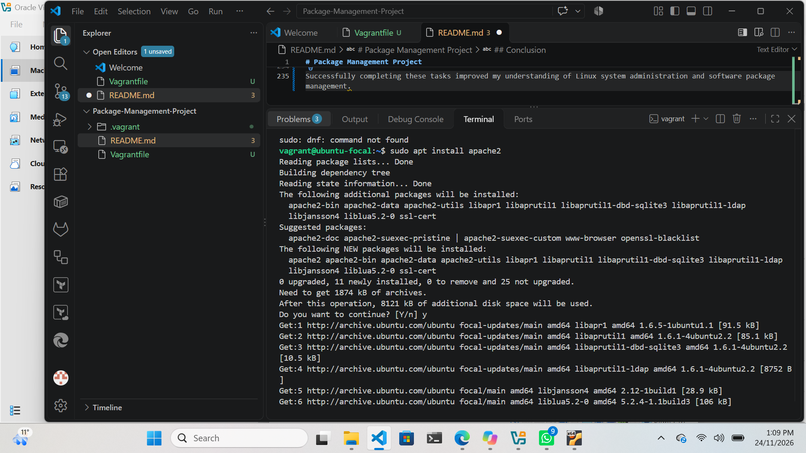
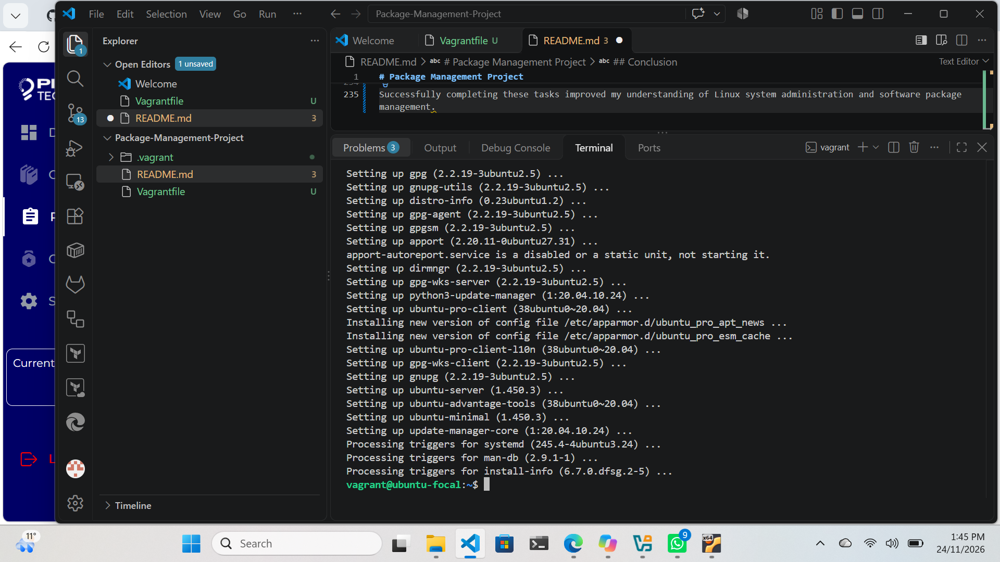
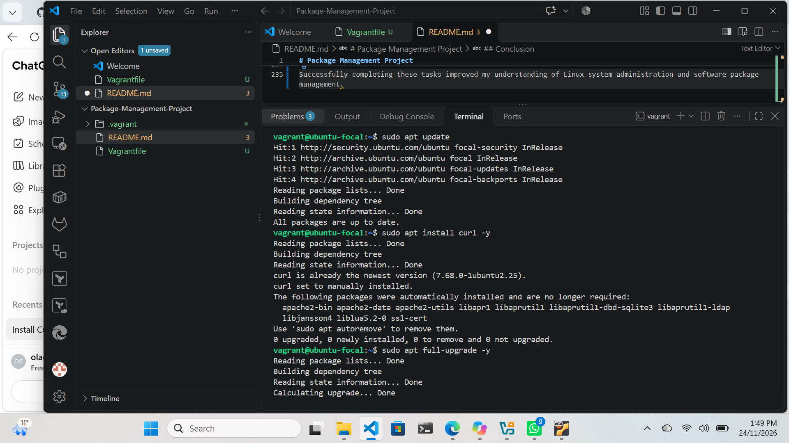
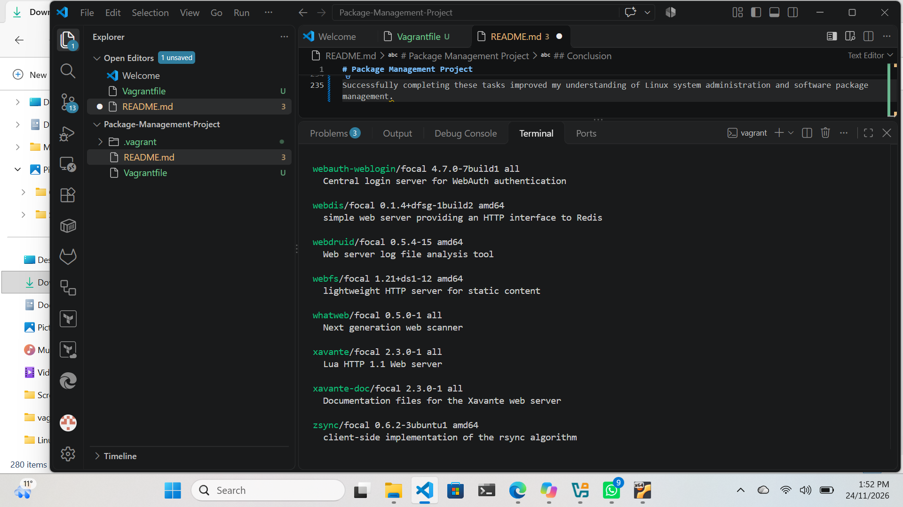
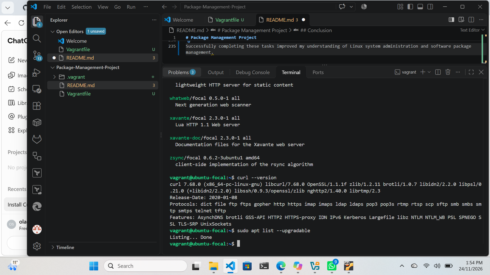

# Package Management Project

## Objective

The objective of this project is to learn how to manage software packages on a Linux system using package management tools such as `apt`, `yum`, and `dnf`.

By completing this project, you will learn how to:
- Update package repositories.
- Install software packages.
- Remove installed packages.
- Search for available packages.
- List installed packages.
- Upgrade installed packages.

## Step 1: Access the Linux System

For this project, I used a Vagrant Linux virtual machine running Ubuntu 20.04.3 LTS.

To access the virtual machine, run:

```bash
vagrant ssh
```

**Expected Output:**

```bash
Welcome to Ubuntu 20.04.3 LTS
GNU/Linux 5.4.0-104-generic x86_64

vagrant@ubuntu-focal:~$
```



## Step 2: Open a Terminal

After accessing the Vagrant virtual machine, use the terminal to execute Linux package management commands.

## Step 3: Update Package Repositories

Before installing or upgrading packages, update the package repository information.

For Debian/Ubuntu systems, run:

```bash
sudo apt update
```

For Red Hat-based systems, use:

```bash
sudo yum update
```

Or:

```bash
sudo dnf update
```

**Expected Output (Ubuntu):**

```bash
Reading package lists... Done
Building dependency tree... Done
Reading state information... Done
All packages are up to date.
```



## Step 4: Install a Package

To install a new package, use the appropriate package manager.

For Ubuntu/Debian:

```bash
sudo apt install apache2
```

For Red Hat-based systems:

```bash
sudo yum install httpd
```

Or:

```bash
sudo dnf install httpd
```



## Step 5: Remove a Package

To remove an installed package:

For Ubuntu/Debian:

```bash
sudo apt remove apache2
```

For Red Hat-based systems:

```bash
sudo yum remove httpd
```

Or:

```bash
sudo dnf remove httpd
```

## Step 6: Search for Packages

To search for available packages using a keyword:

For Ubuntu/Debian:

```bash
apt search keyword
```

For Red Hat-based systems:

```bash
yum search keyword
```

Or:

```bash
dnf search keyword
```

## Step 7: List Installed Packages

To display the packages installed on your Linux system:

For Ubuntu/Debian:

```bash
dpkg --list
```

For Red Hat-based systems:

```bash
rpm -qa
```

Or:

```bash
dnf list installed
```

## Step 8: Upgrade Installed Packages

To upgrade installed packages:

For Ubuntu/Debian:

```bash
sudo apt upgrade
```

For Red Hat-based systems:

```bash
sudo yum upgrade
```

Or:

```bash
sudo dnf upgrade
```



## Step 9: Practical Tasks

As part of this project, I completed the following practical tasks on my Ubuntu Linux virtual machine.

### Task 1: Install curl

The `curl` utility is used to transfer data to and from servers using different network protocols.

Command:

```bash
sudo apt install curl -y
```



To verify the installation:

```bash
curl --version
```



### Task 2: Upgrade the System

After installing curl, upgrade the installed packages on the system.

Command:

```bash
sudo apt upgrade -y
```

### Task 3: Search for Web Server Packages

Search the package repositories for packages related to web servers.

Command:

```bash
apt search "web server"
```

This command displays available packages matching the search term.



## Conclusion

This project provided practical experience in Linux package management using the APT package manager.

I learned how to:
- Access a Linux virtual machine using Vagrant.
- Update package repositories.
- Install and remove software packages.
- Search for available packages.
- List installed packages.
- Upgrade installed packages.
- Install and verify curl.
- Search for web server packages.

Successfully completing these tasks improved my understanding of Linux system administration and software package management.